# ShopNest – Microservices Deployment on Kubernetes using Minikube

**GitHub Repository:** [ShopNest Kubernetes – Microservices](https://github.com/sachindew077-byte/microservices)

## 1. Project Overview

ShopNest is a microservices-based e-commerce application deployed on Kubernetes using Minikube. The application allows users to register, log in, browse products, add products to their cart, and place orders.

This project demonstrates containerization using Docker and application orchestration using Kubernetes.

## 2. Project Objectives

- Deploy a microservices application on Kubernetes using Minikube.
- Build Docker images for individual application services.
- Configure Kubernetes Deployments and Services.
- Enable communication between microservices.
- Configure application secrets and environment variables.
- Test the deployed application.

## 3. Technologies Used

| Technology | Purpose |
|---|---|
| Docker | Containerization |
| Kubernetes | Container orchestration |
| Minikube | Local Kubernetes cluster |
| kubectl | Kubernetes management |
| Node.js | Backend services |
| React.js | Frontend |
| MongoDB Atlas | Database |
| Nginx | Reverse proxy |
| PowerShell | Command-line operations |

## 4. Application Architecture

ShopNest consists of five application components:

1. **User Service:** Registration, login and user management.
2. **Product Service:** Product and category management.
3. **Cart Service:** Shopping cart operations.
4. **Order Service:** Order and checkout operations.
5. **Frontend:** React-based user interface served through Nginx.

Each backend service has its own MongoDB database. The frontend communicates with the backend services through Nginx reverse proxy routes.

### Architecture flow

```text
                    User / Browser
                          |
                          v
                   Frontend Service
                    (Nginx - Port 80)
                          |
          +---------------+---------------+
          |               |               |
          v               v               v
     User Service    Product Service   Cart Service
      Port 3001         Port 3002       Port 3003
          |               |               |
          v               v               v
      MongoDB           MongoDB         MongoDB
       Users            Products         Carts

                          |
                          v
                    Order Service
                     Port 3004
                          |
                          v
                       MongoDB
                        Orders

Inter-service communication:
Cart Service  ------> Product Service
Order Service ------> Cart Service
Order Service ------> Product Service
```

The backend services communicate using Kubernetes internal DNS names, allowing them to communicate within the cluster.

## 5. Project Structure

```text
shop-nest-source/
│
├── backend/
│   ├── user-service/
│   │   └── Dockerfile
│   ├── product-service/
│   │   └── Dockerfile
│   ├── cart-service/
│   │   └── Dockerfile
│   └── order-service/
│       └── Dockerfile
│
├── frontend/
│   ├── Dockerfile
│   └── nginx.conf
│
├── k8s/
│   ├── backend.yaml
│   └── frontend.yaml
│
├── screenshots/
│
└── README.md
```

## 6. Docker Configuration

Separate Dockerfiles were created for all four backend services and the frontend.

The backend images use Node.js 20 Alpine. The frontend uses a multi-stage Docker build with Nginx to serve the React application.

The `.dockerignore` files exclude unnecessary files such as `node_modules`, `.env` files and Git data from the Docker build context.

### Docker configuration screenshots

**Dockerfiles**

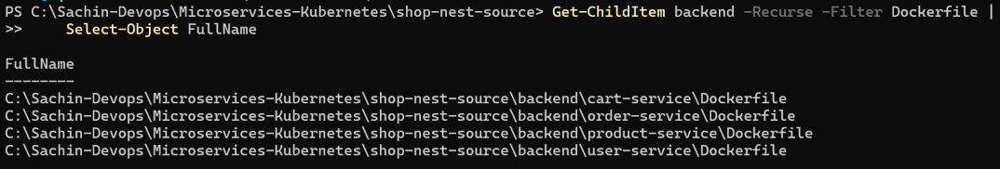

**User Service Dockerfile**

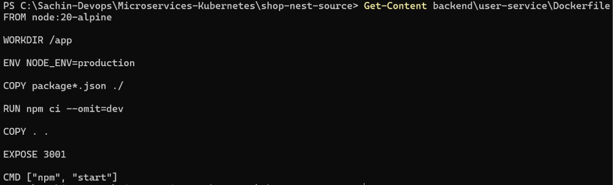

**Frontend Dockerfile**

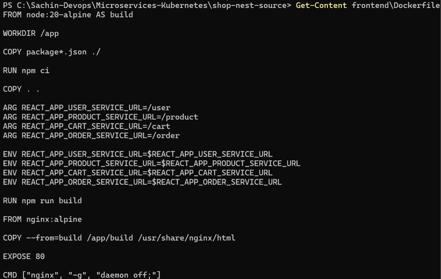

**Docker ignore configuration**

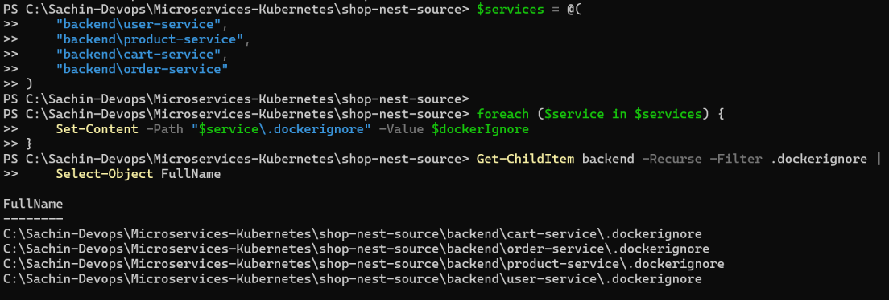

**Nginx reverse proxy configuration**

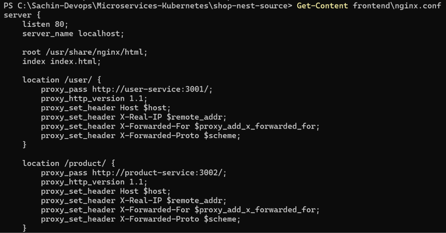

## 7. Building Docker Images

The following Docker images were created:

| Service | Docker Image |
|---|---|
| User Service | `shop-nest-user:1.0` |
| Product Service | `shop-nest-product:1.0` |
| Cart Service | `shop-nest-cart:1.0` |
| Order Service | `shop-nest-order:1.0` |
| Frontend | `shop-nest-frontend:1.0` |

Example build command:

```powershell
docker build -t shop-nest-user:1.0 ./backend/user-service
```

The same process was followed for the remaining services.

### Docker image screenshots

**All Docker images**

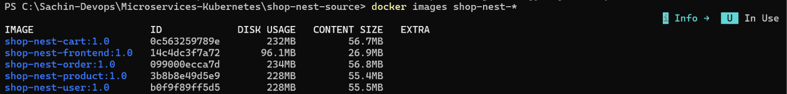

**Backend Service image**


**Product Service image**


**Cart Service image**


**Order Service image**


## 8. Loading Images into Minikube

The locally built Docker images were loaded into Minikube so Kubernetes could use them without pulling them from an external registry.

```powershell
minikube image load shop-nest-user:1.0
minikube image load shop-nest-product:1.0
minikube image load shop-nest-cart:1.0
minikube image load shop-nest-order:1.0
minikube image load shop-nest-frontend:1.0
```

## 9. Kubernetes Configuration

Two Kubernetes manifest files were created.

### backend.yaml

This file defines:

- User Service Deployment and ClusterIP Service.
- Product Service Deployment and ClusterIP Service.
- Cart Service Deployment and ClusterIP Service.
- Order Service Deployment and ClusterIP Service.

### frontend.yaml

This file defines:

- Frontend Deployment.
- Frontend NodePort Service on port 30080.

The backend services use Kubernetes internal DNS names for communication.

### Kubernetes Secrets

A Kubernetes Secret named `shop-nest-secrets` was created to store:

- MongoDB connection strings for all four services.
- JWT secret shared by the services that verify authentication tokens.

Sensitive values were stored in Kubernetes Secrets instead of being included in the application manifests.

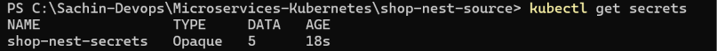

### Deploying the application

```powershell
kubectl apply -f .\k8s\backend.yaml

kubectl apply -f .\k8s\frontend.yaml
```

## 10. Verifying the Kubernetes Deployment

The following commands were used to verify the deployment:

```powershell
kubectl get pods
kubectl get services
kubectl get deployments
```

All five application pods reached the Running state.

The four backend services were exposed internally through ClusterIP Services, while the frontend was exposed using a NodePort Service.

### Kubernetes deployment screenshots

**Backend deployment**


**Frontend deployment**


**Running Kubernetes pods**

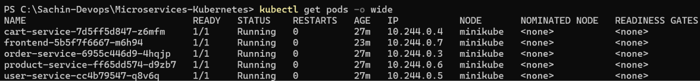

**Kubernetes services**

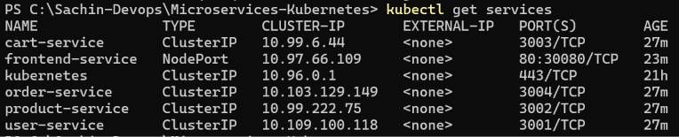

## 11. Database Configuration and Product Seeding

MongoDB Atlas was used to provide database connectivity.

Separate databases were configured for the four backend services:

- `ecommerce_users`
- `ecommerce_products`
- `ecommerce_carts`
- `ecommerce_orders`

The Product Service seed script was executed to add sample categories and products.

```powershell
kubectl exec deployment/product-service -- npm run seed
```

The seeding operation completed successfully, creating 6 categories and 30 products.

## 12. Accessing the Application

The frontend was accessed using:

```powershell
minikube service frontend-service --url
```

Minikube provided a local URL that was opened in a web browser.

The PowerShell tunnel window was kept open while accessing the application.

## 13. Application Testing

The following application functions were tested successfully:

- Opening the ShopNest homepage.
- Viewing the available products.
- Registering a new user account.
- Logging in successfully.
- Adding products to the shopping cart.
- Updating cart quantities.
- Completing the checkout process.
- Placing an order.
- Viewing placed orders under My Orders.

### Application screenshots

**Application launch**

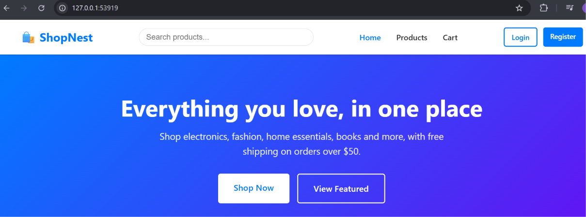

**ShopNest homepage**

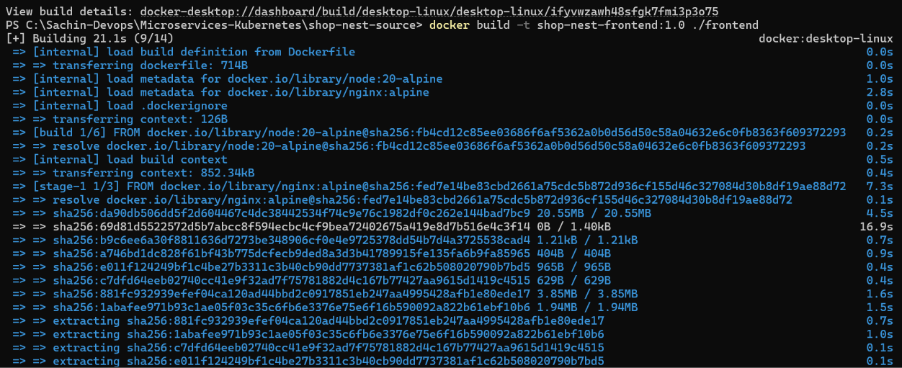

**Products displayed**

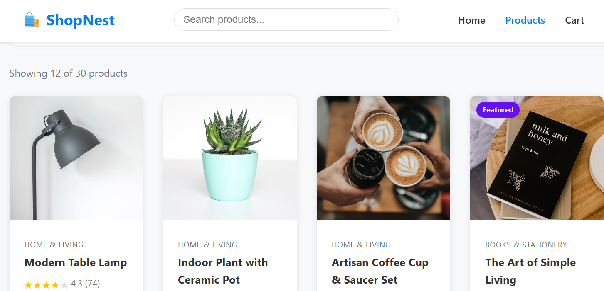

**User registration**

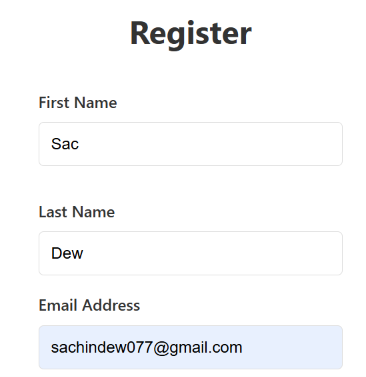

**Shopping cart**

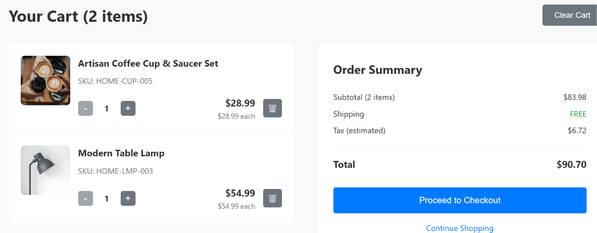

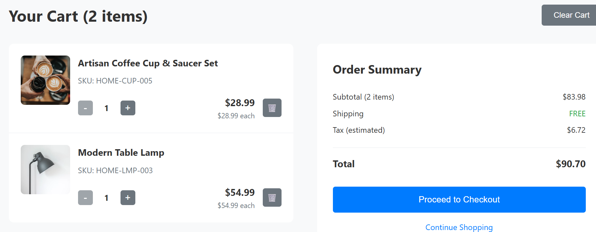

**Checkout**

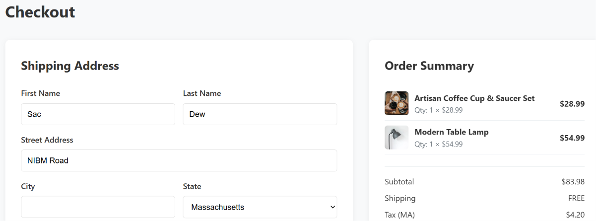

## 14. Challenges and Solutions

| Challenge | Solution |
|---|---|
| Building separate Docker images | Created individual Dockerfiles for each service. |
| Making images available in Minikube | Loaded local images using `minikube image load`. |
| Configuring service communication | Used Kubernetes Service DNS names. |
| Managing database credentials | Stored connection strings in Kubernetes Secrets. |
| Routing frontend API requests | Configured Nginx reverse proxy routes. |
| Verifying application deployment | Used Kubernetes pods, services and deployment commands. |

## 15. Learning Outcomes

Through this project, I learned how to:

- Containerize a microservices application using Docker.
- Build and manage multiple Docker images.
- Deploy applications using Kubernetes.
- Create Kubernetes Deployments and Services.
- Configure environment variables and Secrets.
- Understand communication between microservices.
- Use Minikube and kubectl for local Kubernetes deployment.
- Test an application running inside a Kubernetes cluster.

## 16. References

- [Original ShopNest Source Repository](https://github.com/mohanDevOps-arch/shop-nest)
- [Docker Documentation](https://docs.docker.com/)
- [Kubernetes Documentation](https://kubernetes.io/docs/)
- [Minikube Documentation](https://minikube.sigs.k8s.io/docs/)
- [MongoDB Atlas Documentation](https://www.mongodb.com/docs/atlas/)
- [Node.js Documentation](https://nodejs.org/docs/)
- [React Documentation](https://react.dev/)